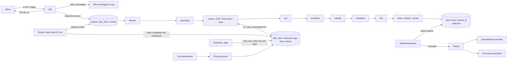

# async-doc-ingestion

Crash-safe, idempotent attachment ingestion and querying for a multi-tenant AI workspace: one async
API to submit any file, extract it, tag it, link it to related files and search it per tenant,
without paying twice for OCR or embeddings.

> An open-source reference implementation of idempotent, crash-safe document ingestion. All names and data are fictional.

[](https://github.com/Tayyab-Bilal/async-doc-ingestion/actions/workflows/ci.yml)

**Scope.** This repo models the ingestion pipeline, the chat-attachment processor, the attachment
query with its fast path, and the later reliability work (sweep, retention, type contract). All
LLMs, OCR, speech-to-text, embeddings, the vector database and the web fetch are deterministic
fakes.

## At a glance

**What it is.** A small reference implementation of a document ingestion service: one async API accepts any file, extracts its text, tags it, links it to related files and makes it searchable per tenant. It is built so a crash, a redelivered message or a re-upload never pays twice for OCR or embeddings.

**What is built**
- Submit, status and delete behind a FastAPI app (`api.py`, `service.py: IngestService.submit`).
- A seven-stage resumable pipeline plus a separate index step (`pipeline.py: Pipeline.process`, `Pipeline.index`).
- A hash check that makes unchanged re-uploads a no-op (`hashing.py: payload_hash`).
- A self-healing sweep with an atomic claim (`sweep.py: sweep`, `store.py: claim_unindexed`).
- A link cascade, chat attachment processor, retention cleanup, and an attachment query with a fast path (`linking.py`, `chat.py`, `retention.py`, `query.py: AttachmentQuery.ask`).
- A per-call context envelope and a metering wrapper with a type contract (`context.py`, `metering.py`).

**What is not built or simplified**
- OCR, speech to text, embeddings, the vector database, the LLM specialists and web fetch are deterministic fakes.
- Submit downloads the file to hash it; a real system would compare a version tag instead.
- The query has no agent loop, spreadsheets are read as plain text, and `normalize` is a toy stemmer.
- Storage is SQLite, and the Celery wiring is shown but never run by the tests.

**How it flows**
1. Submit downloads the file, hashes it and returns "unchanged" if nothing changed.
2. Otherwise it creates or resets the job, returns 202 at once and queues the work.
3. A worker runs each unfinished stage: download, extract, tag, normalize, classify, metadata, link.
4. Extraction saves the OCR job id before polling, so a crash resumes the same OCR job.
5. An empty document stops early and is never indexed.
6. A separate index step embeds the text into the tenant's own collection.
7. The sweep re-runs index for jobs that finished but were never indexed.
8. Queries pick the attachment, take the fast path for empty files and spreadsheets, and otherwise search by dense plus keyword score.

**Run it:** `.venv/bin/pytest -q` gives 79 passed, with no network.

## How each part works, one by one

### 1. Re-upload is a hash no-op
- **Risk / problem:** The same file uploaded again, or the same message redelivered, would pay for OCR and embeddings a second time.
- **How it works:**
  - On submit the service downloads the bytes and builds one fingerprint from the metadata, the sorted labels and the hash of the content (`hashing.py: payload_hash`).
  - Labels are sorted first, so a client sending the same labels in a different order does not count as a change.
  - If the fingerprint and the source URL both match the stored job, it returns "unchanged" and queues nothing, so no stage runs (`service.py: IngestService.submit`).
  - If the URL moved or the bytes changed, derived data and the tenant's vectors for that file are wiped, because an old OCR job id would belong to old bytes. Job history is kept.
  - Simplification: it downloads the file just to hash it. A real system would compare a version tag and skip the download.
- **Tests that prove it:** `tests/test_ingest.py`: `test_unchanged_resubmit_is_noop`, `test_label_order_is_not_a_change`, `test_new_storage_url_wipes_derived_keeps_history`, and 1 more in that file on changed labels (`test_changed_labels_reingests`).

### 2. Crash-safe resume without blind retries
- **Risk / problem:** A worker dies halfway. A blind retry would start a second paid OCR job and redo finished work.
- **How it works:**
  - Every stage saves its progress to the database after it finishes, so a redelivered message skips the done stages and carries on (`pipeline.py: Pipeline.process`).
  - The OCR job id is saved before the service starts waiting on the result. A restarted worker finds the id and re-attaches to the same job instead of starting a new one (`pipeline.py: Pipeline._ocr`).
  - Stages never catch general errors. A crash leaves the job marked running, which is exactly what lets the redelivered message resume it.
  - The queue is set to acknowledge a message only after the task finishes, to put it back if the worker is killed, and to do zero automatic retries (`celery_app.py`).
  - Simplification: a crash in the tiny gap between starting OCR and saving its id can still pay once more. Production would pass the job id as the provider's idempotency key.
- **Tests that prove it:** `tests/test_ingest.py`: `test_crash_after_ocr_start_resumes_same_ocr_job`, `test_resume_skips_finished_stages`, and 1 more in `tests/test_contracts.py` (`test_celery_crash_safety_settings_and_beat_schedule_are_declared`).

### 3. Self-healing sweep with an atomic claim
- **Risk / problem:** A job can finish all its stages but never get indexed, for example if the worker dies at the last step or the vector store is down. Two sweepers might also both re-index it and pay twice.
- **How it works:**
  - Indexing is its own step, so the sweep can redo only that and never redo OCR (`pipeline.py: Pipeline.index`).
  - The sweep looks for completed jobs that are not indexed and are at least fifteen minutes old, so jobs still in flight are left alone (`sweep.py: sweep`).
  - Claiming is one database update that both picks the rows and marks them with a token. The database runs writers one at a time, so two sweepers can never claim the same job (`store.py: claim_unindexed`).
  - The attempt counter goes up at claim time, so a sweeper that dies still counts. After five attempts the job is left for a human, and each run takes at most fifty jobs.
  - Empty documents are skipped, and claims are released afterward so a failed job can be tried again until the cap.
- **Tests that prove it:** `tests/test_sweep.py`: `test_two_concurrent_sweeps_never_double_index`, `test_sweep_respects_min_age_attempt_cap_batch`, `test_sweep_ignores_empty_documents`, and 1 more in that file.

### 4. Empty file is a hard stop
- **Risk / problem:** If an empty attachment fell through to a search, the assistant could answer from a different document and sound confident.
- **How it works:**
  - During extraction, a document with no readable text ends the job as completed with a "no readable content" note, before tagging or indexing (`pipeline.py: Pipeline._extract`).
  - It is never embedded, and the sweep skips it, so nobody pays for it.
  - At question time, an empty file is answered with "no readable content" before any retrieval runs, so no other file can be used instead (`query.py: AttachmentQuery.ask`).
  - Chat attachments follow the same rule: an empty one is recorded as empty and not indexed (`chat.py: ChatAttachmentProcessor.process`).
- **Tests that prove it:** `tests/test_query.py`: `test_empty_workspace_file_is_a_hard_stop_not_another_document`, `test_empty_chat_file_is_a_hard_stop_not_another_document`; `tests/test_chat.py`: `test_empty_attachment_is_a_hard_stop_and_is_not_indexed`, `test_empty_content_stops_before_any_specialist_runs`; `tests/test_ingest.py`: `test_empty_document_never_indexes`.

### 5. Per-call context envelope
- **Risk / problem:** If parallel questions share one "current attachment" slot, the last writer wins and one question reads another question's file.
- **How it works:**
  - Each call carries its own small envelope holding its attachment and tenant, stored in a context variable that each async task gets its own copy of (`context.py: CallEnvelope`).
  - Tasks therefore cannot see each other's values, even when they interleave while waiting.
  - The attachment is chosen by a fixed order: the explicit argument first, then the envelope, then the shared default (`context.py: resolve`).
  - The query uses the same order, so a tool that is never handed an id still reads the right file (`query.py: AttachmentQuery.ask`).
- **Tests that prove it:** `tests/test_context.py`: `test_parallel_queries_do_not_cross_contaminate`, `test_envelope_beats_shared_default_but_explicit_beats_envelope`, `test_resolve_precedence`; `tests/test_query.py`: `test_parallel_queries_each_read_their_own_attachment_via_the_envelope`.

### 6. Tenant isolation by construction
- **Risk / problem:** One tenant must never see another tenant's files or vectors.
- **How it works:**
  - Each tenant gets its own vector collection, so a search simply cannot reach another tenant's data. It is not a filter that could be forgotten (`providers.py: collection_for`).
  - Delete removes rows and vectors from the right collection and reports accurate counts (`service.py: IngestService.delete`).
  - A scoped question for an attachment that belongs to another tenant is answered as "not found" (`query.py: AttachmentQuery.ask`).
  - Link candidates are drawn only from the same tenant, and chat extractions are looked up by tenant as well.
  - Simplification: chat vectors share the tenant's collection and are told apart by a source tag.
- **Tests that prove it:** `tests/test_linking_vectors.py`: `test_vectors_isolated_per_tenant`, `test_delete_removes_rows_and_vectors_with_counts`, and 1 more in that file; `tests/test_query.py`: `test_tenant_boundary_hides_other_tenants_attachments`; `tests/test_chat.py`: `test_chat_extraction_is_tenant_scoped`.

### 7. Wrappers must subclass the library base class
- **Risk / problem:** A metering wrapper that only passed calls through to the embedder failed the vector library's type check, and every document failed to ingest.
- **How it works:**
  - The metered embedder counts billable texts and inherits from the same base class the library checks for (`metering.py: MeteredEmbedder`).
  - A stand-in for the third-party store refuses anything that is not that type, so the original outage is reproduced in the test suite (`metering.py: StrictVectorStore`).
  - The lesson is that duck typing is not enough when a library checks the type of what it is given.
- **Tests that prove it:** `tests/test_contracts.py`: `test_delegating_wrapper_without_the_base_class_is_rejected_by_the_library`, `test_metered_wrapper_subclasses_the_third_party_base_class`, and 2 more in that file.

## The problem

Users attach files everywhere in "Acme Workspace": tasks, projects, meetings, the communication
hub, compliance, spaces and email, and directly inside AI-chat messages. The assistant could read
none of them. Excel and document questions went through two separate tools, and the front end had
to say what type each file was.

The backend needs one asynchronous API that never blocks an upload. OCR is billed per page and
embeddings per text, so a worker crash, a redelivered message or a re-upload of an unchanged file
must never cost money twice.

## What it does

- **Async job API.** Submit returns 202; status polling shows per-stage progress (`api.py`,
  `service.py`).
- **Seven-stage pipeline, then a separate index task:** download, extract, tag, normalize,
  classify, metadata, link; then `index` (`pipeline.py`).
- **Crash safety by idempotent resume,** not blind retries: the OCR job id is saved before
  polling (`pipeline.py`, `celery_app.py`).
- **Re-ingest is a hash no-op;** a new URL wipes derived state and keeps history (`hashing.py`,
  `service.py`).
- **Seven source surfaces:** task, project, meeting, communication hub, compliance, space, email,
  each with its own entity context (`models.py`, `providers.py`).
- **Linking cascade,** bidirectional: keyword Jaccard, then label Jaccard, then exact metadata,
  threshold 0.4 (`linking.py`).
- **Domain and subdomain lookup,** two levels (`pipeline.py`).
- **Per-tenant vector collections;** delete returns accurate counts (`providers.py`).
- **Chat attachments:** audio transcribed inline; other files extracted once into a table so
  queries never re-download; simple RTF support; a URL fetch tool; empty file is a hard stop
  (`chat.py`, `rtf.py`).
- **Unified document routing by stored file type:** spreadsheets go to the spreadsheet and
  document specialists in parallel; the caller never declares a type (`specialists.py`).
- **Attachment query:** hybrid keyword + dense retrieval, a fast path before retrieval, and a
  per-call context envelope for parallel queries (`query.py`, `context.py`).
- **90-day retention cleanup** for chat extractions and their vectors (`retention.py`).
- **Self-healing sweep,** every 10 minutes via Celery beat (`sweep.py`, `celery_app.py`).
- **Type contract for the metering wrapper,** reproducing a real ingestion outage
  (`metering.py`).

## Quickstart

```bash
uv venv .venv && uv pip install -e ".[dev]"
.venv/bin/python examples/demo.py
.venv/bin/pytest -q          # no network, a few seconds
```

Excerpt of the demo output:

```text
== 2. Re-submit the PDF unchanged: a hash no-op
unchanged=True  OCR starts=1  embed calls=3

== 3. Worker crashes right after the OCR job started; the message is redelivered
worker died: worker died after OCR job was started; persisted ocr_job_id=ocr-2
OCR started 1 time(s) for this document

== 6. Chat attachments: extracted once, then read from the table
  offsite.txt: stored
  empty.txt: no_content
  c-2: no_content via -: no readable content
  c-3: ok via spreadsheet+document: [sheet] region,total
  files downloaded while answering: 0

== 7. Retention: chat extractions older than 90 days are removed with their vectors
cleanup: {'extractions': 1, 'vectors': 1}
```

## Usage guide

Wire the service with fakes, submit a file and poll it:

```python
import asyncio
import tempfile
import uuid
from pathlib import Path

from async_doc_ingestion.chat import ChatAttachmentProcessor
from async_doc_ingestion.models import SubmitRequest
from async_doc_ingestion.pipeline import Pipeline
from async_doc_ingestion.providers import Providers
from async_doc_ingestion.query import AttachmentQuery
from async_doc_ingestion.service import IngestService
from async_doc_ingestion.specialists import DocumentRouter, FakeSpecialist
from async_doc_ingestion.store import Store
from async_doc_ingestion.worker import InlineRunner

store = Store(str(Path(tempfile.mkdtemp()) / "readme.sqlite"))
prov = Providers.fakes()
service = IngestService(store, prov, InlineRunner(Pipeline(store, prov)))

req = SubmitRequest(tenant_id="acme", attachment_id=uuid.uuid4(), source_url="s3://docs/q3.txt",
                    filename="q3.txt", mime_type="text/plain", surface="meeting",
                    surface_id="M-3", labels=["finance"])
prov.storage.put(req.source_url, b"Invoice payment and budget for the Q3 roadmap")

job_id, unchanged = service.submit(req)
assert service.status(job_id).status == "completed" and not unchanged
assert service.submit(req) == (job_id, True)        # same file again: no-op
```

Ask a question, with a chat attachment and the workspace:

```python
chat = ChatAttachmentProcessor(store, prov)
prov.storage.put("s3://chat/n.txt", b"The offsite is on Friday.")
chat.process("acme", "c-1", "s3://chat/n.txt", "n.txt", "text/plain")

query = AttachmentQuery(store, prov, DocumentRouter(FakeSpecialist("sheet"), FakeSpecialist("doc")))
chat_answer = asyncio.run(query.ask("When is the offsite?", "acme", attachment_id="c-1"))
wide_answer = asyncio.run(query.ask("Q3 roadmap budget?", "acme"))
assert "offsite" in chat_answer.text and wide_answer.via == "hybrid"
```

More in [docs/usage.md](docs/usage.md); signatures and HTTP routes in [docs/api.md](docs/api.md).

## How it works



**Ingestion.** `submit` downloads the file once, hashes it and either returns "unchanged" or
creates or resets the job and dispatches `process`. The worker runs each unfinished stage and
saves progress after every one. When the last stage finishes, `index` embeds the text and writes
vectors into the tenant's collection. The sweep finds jobs that are `completed` but not indexed
and dispatches `index` again.

**Linking cascade.** For each other attachment of the same tenant, the signals are tried in order:
keyword Jaccard, label Jaccard, exact metadata match. A signal only applies when both sides have
data for it. The first applicable signal that scores at least 0.4 creates the link and its score is
stored; a signal that applies but scores lower falls through to the next. An exact metadata match
scores 1.0. Links are written in both directions.

**Chat.** The processor transcribes audio and returns the text inline. Any other file is
extracted once into `attachments`; the vectors go in the tenant collection tagged
`source=chat`. Empty files are recorded as empty.

**Query.** `AttachmentQuery.ask` picks the attachment (explicit argument, then per-call envelope,
then shared default), then: empty file stops with "no readable content"; a spreadsheet goes to both
specialists in parallel; anything else is retrieved by `0.5 * dense + 0.5 * keyword overlap` and
passed to the document specialist.

## Design decisions

The key mechanisms are explained one by one in [How each part works](#how-each-part-works-one-by-one); this list gives the reasons and rejected options.

1. **Submit returns 202 at once.** Clients poll per-stage progress. Rejected: waiting for OCR in the
   request, which blocks uploads and times out.
2. **Idempotent resume, not blind retries.** Tasks are acked late with zero automatic retries, and
   the OCR job id is saved before polling, so a redelivered message re-attaches to the job in
   flight. Rejected: automatic retries, which pay for a second parse.
3. **Re-ingest is a hash no-op.** SHA-256 over metadata, sorted labels and the content hash. Here
   "source" is the bytes; a production system might compare an ETag or version instead. A changed URL wipes derived state
   but keeps job history.
4. **Index is a separate step.** The sweep can redo it without redoing OCR.
5. **Self-healing sweep, claimed atomically.** One `UPDATE` selects and marks rows, so two sweeps
   never claim the same job and embeddings are never paid twice. Bounded by attempt cap 5, batch
   50 and minimum age 15 minutes. Rejected: unbounded re-dispatch.
6. **Closed status vocabulary.** Four states. A review suggested a "degraded" state for complete
   but unindexed jobs; it was rejected because clients only know four states and a new one would
   strand jobs. They stay `completed`, `indexed=false`, and the sweep fixes them.
7. **Empty file is a hard stop.** An empty attachment must never lead to an answer from a
   different document, so the router and query stop with "no readable content" before any search.
8. **Linking is a cascade with a shared 0.4 threshold,** so different kinds of similarity can
   link files whose text differs. Rejected: keyword-only, which misses files tied by label or
   metadata.
9. **Per-call context envelope.** Parallel queries must not share a single "current attachment"
   slot (last writer wins). Precedence: explicit, per-call, shared.
10. **Per-tenant collections** (`tenant_{id}`): isolation by construction, not by filter.
11. **Wrappers subclass the library base class.** A metering wrapper that only delegated calls
    failed the vector library's `isinstance` check and every document failed. A test now fails
    for a delegating wrapper without the base class.
12. **Retries are not caught.** A stage never catches generic exceptions; a crash leaves the job
    `running` so redelivery resumes it.

## Testing

```bash
.venv/bin/pytest -q
.venv/bin/ruff check .
```

Tests prove rules with counters (OCR `starts`, embedder `calls`, storage `downloads`), not logs.

| Invariant | Test file |
|---|---|
| 202 submit, status, 422 on bad ids, 404s | `test_api.py` |
| OCR runs once across no-op re-uploads and crashes; hash no-op; URL wipe keeps history | `test_ingest.py` |
| Links are bidirectional, per tenant, cascade order and threshold | `test_linking_vectors.py`, `test_linking_cascade.py` |
| Vectors per tenant; delete counts | `test_linking_vectors.py` |
| Seven surfaces, distinct context, `chat` rejected | `test_surfaces.py` |
| Domain and subdomain lookup | `test_domain.py` |
| RTF and PPTX extraction | `test_rtf_and_pptx.py` |
| Sweep bounds, atomic claim under races, empty docs ignored | `test_sweep.py` |
| Parallel queries keep their own file | `test_context.py`, `test_query.py` |
| Chat: audio inline, extract once, no re-download, empty hard stop, URL tool | `test_chat.py` |
| Spreadsheet parallel routing; fast path; hybrid search; tenant wall | `test_chat.py`, `test_query.py` |
| 90-day retention removes rows and vectors | `test_retention.py` |
| Metering wrapper must subclass the base class; Celery settings and beat schedule | `test_contracts.py` |
| Every documented Python snippet runs | `test_docs.py` |

## Limits & known trade-offs

- Hashing needs the bytes, so submit downloads once; an ETag comparison would avoid the download.
- A wipe also happens when bytes change under the same URL, because an OCR job id for old bytes
  would be wrong. Label or metadata-only changes re-run the stages but reuse the OCR job id.
- The atomic claim is portable SQL (`UPDATE ... WHERE job_id IN (SELECT ... LIMIT n) AND
  sweep_token IS NULL`, then select by token). `synchronous=OFF` is for test speed only.
- `normalize` is a toy suffix stemmer standing in for a lemmatizer. The domain lookup is a
  keyword table.
- The query has no agent loop: one specialist call follows retrieval. Chat OCR does not re-attach
  to an in-flight job.
- Spreadsheets are read as text; there is no real sheet parser. RTF handling covers plain text
  only.
- Link candidates must have keywords, so a file made only of stopwords never links.
- Chat vectors share the tenant collection and are filtered by `source=chat`.
- `celery_app.py` needs `uv pip install -e ".[celery]"`; tests read it as text and never import it.

## Project layout

```text
src/async_doc_ingestion/
  models.py       request/job models, stages, the seven surfaces
  store.py        SQLite tables, atomic claim, chat table
  hashing.py      the re-ingest hash
  providers.py    protocols, fakes with counters, entity context per surface
  pipeline.py     the stages, domain lookup, index step
  linking.py      the three-signal link cascade
  service.py      submit / status / delete
  api.py          FastAPI routes
  worker.py       Runner protocol and inline runner
  celery_app.py   Celery settings, tasks, beat schedule
  sweep.py        self-healing sweep
  context.py      per-call envelope
  rtf.py          RTF to text
  chat.py         chat attachment processor, URL fetch tool
  specialists.py  document routing and fake specialists
  query.py        attachment query: fast path and hybrid search
  retention.py    90-day cleanup
  metering.py     metered embedder and the type-contract stand-in
tests/            one file per area, plus docs execution
examples/demo.py  end-to-end story
docs/             usage.md, api.md
```

## License

MIT
